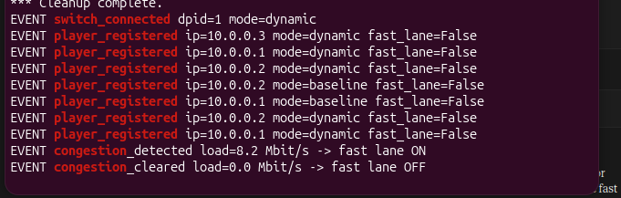
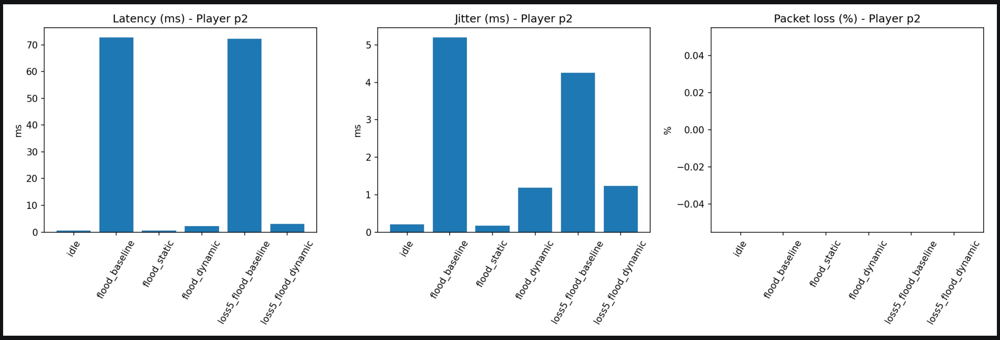
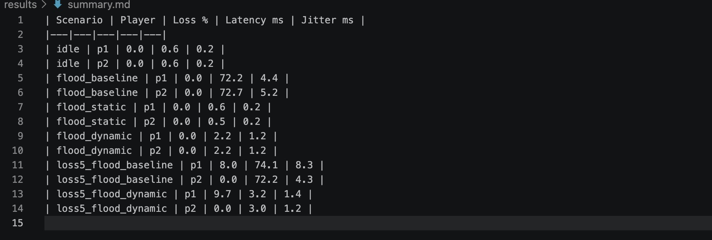

# Project 17 - Multiplayer Game Communication Network (UDP + SDN Traffic Prioritisation)

**PES University, Bengaluru | Dept. of CSE (AI & ML) | Computer Networks (UE25CS243A) | Group 13, Project 17**

Full project report: [`docs/Project17_Multiplayer_Game_Communication_Network_Report.pdf`](docs/Project17_Multiplayer_Game_Communication_Network_Report.pdf)

**Quick start**
```bash
./setup.sh                                   # one-time install (Mininet, OVS, Ryu deps)
pip install -r requirements.txt              # inside a Python 3.9 venv (.venv-ryu)
sudo mn -c                                   # clean old Mininet state FIRST
./run_controller.sh                          # Terminal 1 (leave open)
sudo python3 demo.py                         # Terminal 2: live demo
sudo python3 run_experiments.py              # Terminal 2: full evaluation
```


## 1. Problem and objectives
Real-time multiplayer games send small UDP packets (player positions) many times per second. When the
network is congested, those packets suffer **latency, jitter and loss**, so the game lags.
**Objective:** build a UDP game system in Mininet where an **SDN controller detects congestion and
prioritises game traffic dynamically**, and prove with measurements that it helps.

## 2. Architecture
```
 gs 10.0.0.10 (port 1: 10 Mbit/s bottleneck, queue 0 slow / queue 1 fast)
 p1 10.0.0.1 (port 2)   p2 10.0.0.2 (port 3)   p3 10.0.0.3 (port 4, intruder)   bg 10.0.0.20 (port 5, flood)
        \                    |                      |                |                /
         +----------------------- s1  (Open vSwitch, OpenFlow 1.3) ----------------+
                                   |   OpenFlow
                          Ryu controller (127.0.0.1:6653)
```
| File | Role |
|---|---|
| game_server.py | UDP server, 2 sockets / 2 threads (registration 5001, game data 5000) |
| game_client.py | player: register (retries), send numbered updates, measure loss/latency/jitter |
| controller.py | Ryu app: default-drop, registration-triggered rules, congestion monitor, 3 modes |
| topo.py | Mininet topology + 2 priority queues on the server port |
| demo.py | live demo with 5 tests |
| run_experiments.py | full evaluation, CSV + table + graph |
| mode.txt | controller mode: baseline / static / dynamic |
| setup.sh / run_controller.sh | dependency installation / controller launcher |
| requirements.txt | Python dependencies |
| docs/ | project report (PDF) |
| results/ | experiment CSV, summary, graph, demo output, server log |
| screenshots/ | demo evidence images |

## 3. Application protocol (UDP, text)
| Message | Port | Reply |
|---|---|---|
| `REG <name>` | 5001 | `ACK` (client retries up to 5 times if no ACK) |
| `UPD <name> <seq> <time> <x> <y>` | 5000 | `STATE <seq> <time> <players>` |
- **Sequence number** -> server counts gaps = lost packets; client ignores stale replies.
- **Timestamp** echoed back -> client computes latency (RTT).
- **Jitter** = mean absolute difference between consecutive latencies.
- Registration is retried (must not be lost); game updates are NOT retried (old positions are useless).

## 4. SDN design (flow table)
| Priority | Match | Action |
|---|---|---|
| 0 | anything | DROP (default deny, blocks unregistered players) |
| 10 | ARP | flood |
| 10 | ICMP / registration ACKs / background traffic | forward (queue 0) |
| 20 | UDP dst 5001 -> server | queue 1 + server + **copy to controller** |
| 30 | per registered player: UDP -> server:5000 | server (+ `set_queue:1` when prioritising) |

**Socket -> SDN integration:** the `REG` packet is copied to the controller, which installs the player's rules.
**SDN -> network behaviour:** unregistered traffic is dropped; registered traffic is prioritised.

**Modes:** `baseline` never prioritises; `static` always prioritises registered players;
`dynamic` (proposed) prioritises only while congestion is detected.
**Dynamic logic:** every 1 s the controller reads port-1 byte counters (OpenFlow PortStats), computes Mbit/s;
> 7 -> `congestion_detected` (rules rewritten with `set_queue:1`); < 5 twice in a row -> `congestion_cleared`.

## 5. How to reproduce (Ubuntu)

### Prerequisites
- Ubuntu Linux
- Mininet and Open vSwitch
- Python 3.9 virtual environment
- Ryu 4.34
- iperf and netcat
- Matplotlib (for experiment graphs)

### Start the controller
Open Terminal 1:

    cd ~/CN-Project17-Multiplayer-Game-Communication-Network
    source .venv-ryu/bin/activate
    ryu-manager --verbose --ofp-tcp-listen-port 6653 controller.py

Wait until the controller starts and connects to the switch.

### Run the live demonstration
Open Terminal 2:

    cd ~/CN-Project17-Multiplayer-Game-Communication-Network
    sudo python3 demo.py

### Run performance evaluation
Keep the controller running and execute:

    sudo python3 run_experiments.py

The evaluation generates:
- results/results.csv
- results/summary.md
- results/comparison.png

Do not run `sudo mn -c` while the controller is active.
Run Mininet cleanup before starting the controller if required.

## 6. Test cases
| # | Test | Expected |
|---|---|---|
| T1 | pingall | 0% dropped |
| T2 | unregistered p3 sends game packets (unauthorized access) | 100% loss |
| T3 | p1,p2,p3 register and play, idle network | 0% loss, latency of a few ms |
| T4 | 20 Mbit/s flood, baseline | high latency/jitter/loss |
| T5 | 20 Mbit/s flood, dynamic | `congestion_detected` after ~1-2 s, then low latency |
| T6 | congestion + 5% packet loss on p1's link | lower latency under dynamic prioritisation; packet loss may remain |

## 7. Experiments (run_experiments.py)
Scenarios: idle; flood with baseline / static / dynamic; flood + 5% link loss with baseline / dynamic.
3 runs each, 100 packets per player (p1, p2), metrics: loss %, latency ms, jitter ms.

## 8. Performance evaluation and results

Experiments were conducted using six scenarios, with three runs per
scenario and 100 packets per player per run.

### Results

See:
- `results/summary.md` — numerical summary
- `results/results.csv` — raw measurements
- `results/comparison.png` — performance comparison graph
- `results/d1_output.txt` — live demonstration output
- `results/server.log` — server activity log

### Analysis

Under background UDP flooding, dynamic SDN prioritisation reduced
average p2 latency from approximately 72.7 ms (baseline) to 2.2 ms.
This is approximately a 97% reduction.

Average jitter decreased from approximately 5.2 ms to 1.2 ms.

Static prioritisation achieved approximately 0.5 ms latency under
flooding because registered game traffic was always prioritised.
Dynamic prioritisation activates only when congestion is detected,
avoiding permanent prioritisation during idle conditions.

Under the configured 5% link-loss impairment, packet loss remained
variable and was not eliminated by SDN prioritisation. However,
latency remained substantially lower under dynamic prioritisation.

These results demonstrate the benefit of congestion-aware traffic
prioritisation for latency-sensitive UDP game traffic in the tested
Mininet topology.

### Experimental limitations

The evaluation uses a small virtual network, three runs per scenario,
and 100 packets per player per run. Results may vary with scheduling,
virtualisation overhead and network conditions.


### Demo screenshots

**Controller events** (socket registration -> SDN rules; congestion detected; congestion cleared):



**Live demo results** (`demo.py`, saved in `results/d1_output.txt`). Columns: player, sent, received, loss %, latency ms, jitter ms.

| Test | Result |
|---|---|
| T1 pingall | 0.0% dropped |
| T2 unregistered p3 plays | `('p3', 10, 0, 100.0, 0.0, 0.0)` - fully blocked |
| T3 p1,p2,p3 registered, no congestion | 0% loss, ~0.6 ms latency, ~0.25 ms jitter |
| T4 flood, baseline | 0% loss, **~72.3 ms** latency, ~3.5 ms jitter |
| T5 flood, dynamic | 0% loss, **~3.0 ms** latency, ~1.9 ms jitter |

**Performance comparison graph** (player p2; p2 had 0% loss in every scenario, so the loss panel is empty):



**Numerical summary** (`results/summary.md`):



## 9. Limitations / future work
Single switch; priority decided per registered player only; thresholds are fixed (7/5 Mbit/s);
queues are configured once. Future: per-flow metering, multiple bottlenecks, link-failure rerouting.

## 10. Team
| Member | Responsibility |
|---|---|
| Chirag (PES1UG25AM481) | Problem and architecture, UDP protocol design, game_client.py (registration retries, sequence numbers, latency/jitter/loss), results analysis (baseline vs static vs dynamic) |
| Taran (PES1UG25AM485) | controller.py (flow rules, registration-to-SDN integration, congestion detection and dynamic prioritisation), run_experiments.py, challenging scenarios |
| Hisham (PES1UG25AM488) | game_server.py (two sockets, threads, registration, loss detection), topo.py (topology, queues), demo.py, documentation and GitHub |
